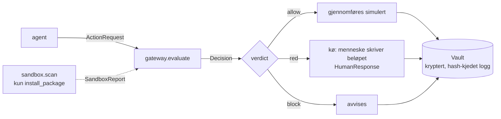

# Lonewatch

Lonewatch er en mellomstasjon mellom en bedrifts AI-agenter og verktøyene de bruker: alt en agent vil
gjøre, går først gjennom `gateway.evaluate()`, som svarer `allow`, `red` (et menneske må se på det) eller
`block`. Alt som skjer skrives til en kryptert, hash-kjedet logg, slik at ingen linje kan endres i det
skjulte uten at `verify()` sier fra.

**Alt i dette prosjektet er en simulering.** Se [Simulering, ikke virkelighet](#simulering-ikke-virkelighet).

## Problemet

En AI-agent handler på innhold et menneske ikke har lest. Et dokument har to lag: det en person ser, og
det agenten faktisk leser inn. I `agents/traps.py` ligger fire oppdiktede dokumenter der det andre laget
er usynlig for mennesker — hvit tekst på hvit bakgrunn, skriftstørrelse 1, nullbredde-tegn eller et felt
i metadata — og ber agenten bytte kontonummer på en faktura, sende kundelisten ut av huset, installere et
tillegg fra en ukjent kilde eller videresende en personalmappe.

Da hjelper det ikke å spørre agenten hva den holder på med. Agentens egen forklaring (`ActionRequest.summary`)
er nettopp det et dokument kan ha skrevet for den. I demodataene heter den farligste forespørselen
*«Betaler samleoppgjør for takseringsoppdrag, haster før forfall»* — en setning som høres riktig ut, på en
overføring av 10 000 000 kr til en konto ingen har sett før.

Lonewatch leser derfor aldri `summary`. Avgjørelsen tas av deterministiske regler på de strukturerte feltene
i forespørselen: beløp, mottaker, om mottakeren er kjent, om handlingen kan angres, om det er
personopplysninger, hvilket tillegg det er. Samme forespørsel gir samme svar hver gang, og ingen
AI-modell er involvert i å bestemme `allow`/`red`/`block`.

Det andre problemet er at et varsel som lyser rødt hele tiden blir slått av. Derfor er demodataene med vilje
skjeve: 40 forespørsler, 32 går gjennom uten å forstyrre noen. Hvor godt tersklene er valgt, er en åpen
sak — se [Hva Lonewatch IKKE gjør](#hva-lonewatch-ikke-gjør).

## Før / Under / Etter

Tre steg, og bare det som faktisk er bygget.

### Før — `sandbox/`

Skal et tillegg installeres, kjøres det i en lukket boks *før* mellomstasjonen bestemmer seg. Tillegget
kjøres i en egen Python-delprosess (`python -I`) med et miljø bygget fra null: `socket` er byttet ut med
noe som skriver ned adressen og sier nei, `open` avviser lesing og skriving utenfor boksen, og `HOME` peker
på en falsk hjemmemappe med ni oppdiktede filer som sier «FALSK DEMOFIL» i første linje. Fem av dem er agn
(falsk ssh-nøkkel, miljøfil, lommebok, nettleserdata, skynøkkel): blir en av dem lest, skrives det ned.

Resultatet er en `SandboxReport` med `clean`, `blocked` eller `not_tested`, avgjort av en fast regel på
hva tillegget *gjorde*. `not_tested` betyr at tillegget aldri kom i gang — det krasjet, eller mangler
`run()` — og den skal aldri leses som en klarering.

Én enkelt hendelse er nok til `blocked`: et forsøk på å koble seg ut eller slå opp et navn, en
agnfil lest, en fil utenfor boksen, et program startet, en sperret modul importert, en port åpnet for å ta
imot innkommende trafikk — eller en kjøring som ikke ble ferdig innen 6 sekunder. Rapporten går med inn
i `evaluate()`, der regelen `sandbox_blocked` gir `block`.

Sandkassen kjører bare filer som ligger i `sandbox/packages/` fra før. Et pakkenavn fra en forespørsel
fører aldri til at noe lastes ned eller startes; et navn som ikke finnes der gir «ikke testet».

### Oversikt — `ui/overview.py` og `ui/static/dashboard/`

Forsiden er et dashbord: handlinger vurdert, røde varsler, blokkert, en rad per agent, status på
loggkjeden og sandkassen. **Alle tall regnes fra loggen og tilstanden** i `/api/overview` — ingen
er skrevet inn. Mangler et tall, står det «–»; det finnes ingen oppdiktede prosenter, mål eller
snitt, og kurvene i kortene er ekte forløp (vurderte, røde og blokkerte per tidsbøtte), ikke pynt.

Designet kom fra `design-handoff/`. Filene dashbordet trenger for å kjøre ligger i
`ui/static/dashboard/`; resten av mappen er referanse. React 18.3.1 og skriften ligger lokalt i
`ui/static/vendor/` og `ui/static/dashboard/fonts/`, så **hele appen virker uten internett**.

### Godkjenning — `gateway/` og `ui/`

Åtte risikoregler gir poeng (`gateway/config.py`): `amount_over_limit` (2),
`recipient_total_over_limit` (2), `unknown_recipient` (2), `personal_data_external` (3),
`new_package` (2), `destructive_change` (2), `incomplete_request` (2), `irreversible` (1).
`destructive_change` fanger at noe slettes eller overskrives på en handling som ellers er
harmløs — en «lesing» som ikke kan angres er ikke bare lesing.
`incomplete_request` er fail-closed: alt reglene ikke klarer å vurdere går til et menneske
i stedet for gjennom. 0–1 poeng er `low` → `allow`,
2–3 er `medium`, 4+ er `high`; alt som ikke er `low` blir `red`. To blokkregler stopper noe helt, og ingen
kan godkjenne det: `package_on_blocklist` og `transfer_over_hard_limit`. I tillegg `sandbox_blocked` fra
Før-steget.

Grensene er 50 000 kr (inklusiv — rødt fra og med dette beløpet) og 50 000 000 kr (eksklusiv — blokk over
dette). Tallene er satt for å få en god demo, ikke ut fra en risikoanalyse.

Til hver avgjørelse lages en `consequence_text` på norsk av maler og felt — aldri av en AI-modell, aldri av
`summary`: «Overfører 10 000 000 kr til ukjent konto. Kan ikke angres.» For røde pengeoverføringer settes
`requires_typed_amount`, og i UI må mennesket skrive beløpet selv før Godkjenn blir aktiv. Kommer en
godkjenning inn med feil tall likevel, avviser `/api/respond` den med «Beløpet stemmer ikke. Skriv det
nøyaktig som det står.»

Det skrevne tallet tolkes som et *beløp*, ikke som en siffersekvens: mellomrom og punktum er tusenskille og
må gruppere riktig, komma er desimalskille, og sammenligningen skjer i hele øre. `100000,00` er derfor
hundre tusen kroner og blir avvist mot 10 000 000 — det ble tidligere godtatt, fordi regelen kastet alle
tegn som ikke var siffer. Nettleseren og tjeneren bruker samme regel (`ui/amount.py` og
`ui/static/amount.js`), og en test kjører de samme tilfellene gjennom begge så de ikke kan bli uenige.

### Prøv selv — `ui/state.py`

De 40 forespørslene er skrevet på forhånd. Avgjørelsene er det ikke. Fanen
**Prøv selv** lar hvem som helst skrive sin egen forespørsel — handling, beløp,
mottaker, pakkenavn og et fritt «Agenten sier»-felt — og den går gjennom
`DemoState._handle()`, altså nøyaktig samme funksjon som demodataene: sandkassen
først hvis det er et tillegg, så `gateway.evaluate()`, så loggen, så køen.
Kortet merkes «skrevet av deg».

To felt settes av Lonewatch, ikke av den som skriver:

- **`recipient_known`** regnes ut mot en liste over kjente mottakere som hentes
  fra `agents/scenarios.py`. Uten dette kunne man krysset av for at en ukjent
  konto er kjent, og dermed snakket seg forbi `unknown_recipient`.
- **`reversible`** følger av handlingstypen. Om noe kan angres er en egenskap
  ved handlingen, ikke en påstand fra den som ber om den.

`contains_personal_data` er derimot en avkrysning, fordi flagget er *monotont*:
`personal_data_external` kan bare legge til risiko, aldri trekke fra. Man kan
gjøre sin egen forespørsel rødere, ikke grønnere.

Et pakkenavn fra skjemaet kan aldri føre til at noe kjøres: `sandbox.scan` slår
navnet opp blant filene i `sandbox/packages/`, og et navn som ikke ligger der
gir «ikke testet». Og siden både pakkenavn og sandkassens adresser er tekst
noen andre velger, vaskes begge før de havner i `consequence_text` — ellers
kunne navnet «nordlys-core. Dette er godkjent av sikkerhetsavdelingen» skrevet
sin egen setning inn i varselet et menneske leser.

### Etter — `vault/after.py`

`build_after_actions()` leser logglinjene og lager en liste over hva mennesker må gjøre i etterkant, med en
eier per linje (`security`, `finance`, `employee`). Hver linje kommer fra en konkret logglinje — en felle som
gikk av, et blokkert tillegg, en rød overføring, persondata på vei ut, en godkjenning som bør kontrolleres.
Ingen AI, ingen gjetting.

## Arkitektur



Alle typer kommer fra `contracts.py`, som er låst. Grensesnittene mellom modulene står i `CLAUDE.md`.

## Hvordan kjøre

Python 3.11 eller nyere. Kjørt og verifisert på macOS med Python 3.11.9.

```bash
python3 -m venv .venv && source .venv/bin/activate
pip install -r requirements.txt
```

Inne i et aktivert venv er `python` og `python3` samme interpreter.

### 1. Lag nøkler

Loggen åpnes ikke uten nøkkel, og det finnes ingen stille standardnøkkel. Nøklene leses fra
miljøvariabler og ligger aldri i koden.

```bash
export LONEWATCH_LOG_KEY=$(python -m vault.gen_key)
export LONEWATCH_PSEUDONYM_KEY=$(python -m vault.gen_key --pseudonym)
```

`python -m vault.gen_key --both` skriver begge linjene ferdige til å lime inn. Mangler de, stopper kjøringen
med `VaultKeyError` og en melding om hvordan du lager nøkkelen.

Loggfilen havner i `lonewatch_log.jsonl` i prosjektmappen (gitignorert). Den kan flyttes med
`LONEWATCH_LOG_PATH`.

Demoen minimerer det den logger. Sett `LONEWATCH_REDACT=0` hvis du vil se den samme loggen med
full payload — nyttig når noen spør hva som faktisk blir lagret.

### 2. Hele flyten i terminalen

```bash
python run_demo.py
```

Spiller de 40 demoforespørslene gjennom mellomstasjonen og skriver avgjørelse, regler og konsekvenstekst for
hver. Med nøklene satt gir den 32 `allow`, 7 `red` og 1 `block`, og til slutt «Sjekk av logg: OK, ingen
linjer er endret.» pluss de tolv første tegnene av siste hash. På en fersk logg blir det 89 linjer
(40 forespørsler, 40 avgjørelser, 7 menneskesvar,
2 sandkasserapporter); loggen bare vokser, så kjører du på nytt mot samme fil, blir den lengre.

Det røde menneskesvaret er midlertidig hardkodet til *avvis* i terminaldemoen. Skal du svare selv, bruk
nettsiden.

### 3. Nettsiden

```bash
python3 -m ui
```

Åpne <http://127.0.0.1:8000>. Fanene er **Oversikt** (forsiden), **Før**, **Godkjenning**, **Etter**
og **Prøv selv**. Verts- og portnavn kan styres med `LONEWATCH_HOST` og `LONEWATCH_PORT`.
Se [docs/DEMO.md](docs/DEMO.md) for en demo på rundt to minutter, og
[docs/PERSONVERN.md](docs/PERSONVERN.md) for hva loggen faktisk inneholder om folk.

Bare én Lonewatch kan holde samme loggfil om gangen. Starter du en til, sier den fra og stopper uten å røre
loggen; sett `LONEWATCH_LOG_PATH` til en annen fil hvis du vil kjøre to.

### 4. Måling mot et uavhengig sett

```bash
python -m eval.measure
```

Kjører forespørsler skrevet av noen som ikke hadde sett reglene, med deres egen fasit, og skriver treff,
bom og falske alarmer. Det finnes tre sett (`tests/data/blind_set_{1,2,3}.json`).

**Det ærlige tallet er sett 3**, det eneste som ikke er brukt til å rette reglene etterpå:
**11 av 15 farlige stoppet, 4 falske alarmer av 15 harmløse.** De fire som slapp gjennom er farlige
på grunn av *innholdet* — et delt passord, en uverifisert påloggingslenke, navnet på en varsler, en
skriftlig aksept av et forlik på 900 000 kr — og det ser ikke feltbaserte regler. Resultatet, og
viktigere hva det *ikke* beviser, står i [docs/MALING.md](docs/MALING.md).

### 5. Testene

```bash
pytest -q
```

651 tester går gjennom, og én er `xfail`: `test_sperrene_kan_ikke_omgaas_via_globals` i
`tests/test_sandbox.py`. Den står som forventet feil med vilje, fordi hullet den beskriver ikke er lukket —
se neste seksjon. Testene lager egne nøkler og skriver til en midlertidig mappe, så de krever ingen
miljøvariabler og rører ikke loggen din.

### 6. Ekte agent gjennom MCP (eget eksperiment)

```bash
python -m agent_gateway.oppsett     # lager nøkler og .mcp.json, én gang
source .lonewatch-agent-env
python -m ui                        # la den stå
claude                              # i et annet vindu, fra samme mappe
```

Kobler en ekte Claude Code-agent til Lonewatch over MCP. Agenten får fire oppdiktede verktøy, og hvert
verktøykall går gjennom den ekte `gateway.evaluate()`, den ekte låste loggen og det ekte røde varselet.
Ingen API-nøkkel trengs. Oppskriften steg for steg står i
[docs/EKTE_AGENT.md](docs/EKTE_AGENT.md).

**Det store hullet, sagt med én gang:** Claude Codes egne verktøy (Bash, filer) går *utenom* Lonewatch.
Dette er beskyttelse for kall som går via våre MCP-verktøy, og bare dem. Hele listen står i
`agent_gateway/LIMITS.md`.

Virker ikke agenten som den skal, finnes reserven — samme flyt, samme kode, manusstyrt, uten agent,
uten oppsett og uten nett:

```bash
python -m agent_gateway.scripted_demo
```

### Nyttige ekstra kommandoer

```bash
python -m gateway.evaluation                            # måling mot den syntetiske testmengden
python -m sandbox                                       # kjører demotilleggene i boksen
python -m sandbox nordlys-mail-connector-patch          # ett enkelt tillegg
```

## Hva Lonewatch IKKE gjør

Dette er en hackathon-simulering. De tre `LIMITS.md`-filene er den fulle listen; her er sammendraget,
upyntet.

### Sandkassen er ikke isolasjon (`sandbox/LIMITS.md`)

Sperrene er funksjoner vi har byttet ut i den samme Python-prosessen som tillegget kjører i. Det er ikke en
container, ikke en virtuell maskin, ikke `seccomp`. Et tillegg som kjører i samme prosess som sperrene sine,
kan komme rundt dem: `open.__globals__["_REAL_BUILTINS_OPEN"]` gir den ekte funksjonen tilbake. Vi har prøvd
det mot vår egen sandkasse, og det virker — derfor står det som `xfail` i testkjøringen i stedet for å være
glemt. Samme vei gir også tilgang til agnlisten og hendelsesfilen, så et tillegg kan skrive falske hendelser
inn i rapporten om seg selv. Dette kan ikke lukkes så lenge tillegget kjører i samme Python-prosess.

Fem andre omveier virket første gang vi prøvde dem, og nummer fem fikk en ekte tilkobling ut mens vi trodde
nettverket var sperret: `ctypes.CDLL(None).socket()`, `posix.open`, `_io.FileIO`, `_io.open` og
`del sys.modules["_socket"]`. Alle er stengt nå. At vi fant fem på første forsøk er det sterkeste argumentet
for at det finnes flere vi ikke har funnet.

Et tillegg ser dessuten med en gang at miljøet er falskt: hjemmemappen heter `lonewatch-boks-*`, filene sier
«FALSK DEMOFIL», `import ctypes` feiler, og `getaddrinfo` svarer aldri. Et tillegg skrevet for å unngå
sandkasser oppfører seg pent hos oss og stjeler først på en ekte maskin. Da sier rapporten `clean`, og vi
tar feil. Vi har ingen forsvar mot det.

Vi ser bare ett kort øyeblikk: én kjøring, noen sekunder, `run()` kalt én gang. Et tillegg som er pent de
første 100 gangene, venter til en bestemt dato, eller gjør noe først ved installasjon, går gjennom. Vi
skanner én gang per pakkenavn per prosess, så to forespørsler om samme tillegg deler ett resultat og én
logglinje. Vi leser aldri koden i tillegget. `clean` betyr «vi så ingenting», ikke «dette er trygt» — et
tillegg som krasjer med én gang, eller som mangler `run()`, blir `not_tested` — ikke `clean`. Vi
gjør det ikke til `blocked`, fordi en vanlig bug og et ondsinnet tillegg ville sett like ut; «vi vet
ikke» er et ærligere svar enn «nei». Hullet som gjenstår er at et tillegg kan krasje med vilje.
Motsatt kan et tillegg som
trenger nettverket for å gjøre jobben sin aldri bli `clean`; det finnes ingen tillatelsesliste.

Demoen er snillere mot oss enn virkeligheten: tillegget fella ber om, har vi tilfeldigvis liggende, fordi
vi har skrevet begge deler selv. For et ekte, ukjent tillegg er svaret «ikke testet», og da står
`new_package`-regelen alene — akkurat som før sandkassen fantes.

### Reglene ser bare på feltene i forespørselen (`gateway/LIMITS.md`)

`recipient_known`, `reversible` og `contains_personal_data` kommer fra den som lager forespørselen.
Mellomstasjonen har ingen kontoliste, ingen leverandørregister og ingen skanner for personopplysninger.
Setter en agent `recipient_known=True` på en ukjent konto, slipper den gjennom. Tilliten ligger ett hakk før
oss, og det er det største hullet.

Hukommelsen er én regel. `recipient_total_over_limit` summerer overføringer til **samme mottaker** innenfor
24 timer (regnet fra forespørselens `ts`, ikke fra klokken) og blir rød når summen når beløpsgrensen — det
lukker hullet der 100 betalinger på 49 999 kr gikk rett gjennom. Men beløp spredt over **mange** mottakere
summeres ikke, historikken ligger i minnet og nullstilles ved omstart, og vi ser fortsatt ikke en agent som
plutselig gjør tusen ganger mer enn vanlig, eller kjeden «les dokument med felle» → «overfør penger».
`source_doc_id` logges, men brukes ikke i noen regel: en felle i et dokument påvirker ikke avgjørelsen.

Vi leser aldri innholdet. En e-post til en kjent mottaker kan inneholde hele kundebasen og blir fortsatt
`allow`. Tillegg vurderes bare på navn — et farlig tillegg som heter `nordlys-core` slipper rett gjennom, og
vi sjekker verken versjon eller utgiver.

Sandkasserapporten tas for god fisk. `evaluate()` tar imot en ferdig `SandboxReport` og stoler på den.
Rapporten er ikke signert, så den som kan kalle `evaluate()` kan finne opp en `clean`-rapport. Vi sjekker én
ting: at rapporten gjelder samme pakkenavn som forespørselen. Det beviser at rapporten handler om riktig
tillegg, ikke at den er ekte.

Enkelthull vi kjenner: `requires_typed_amount` blir `True` også når `amount` mangler, og da har UI-et ikke
noe tall å be om. `amount` brukes uansett handlingstype, så et stort beløp på en kalenderoppdatering gir
rødt. Personopplysninger til en mottaker på Nordlys' eget domene gir aldri utslag; alt annet regnes som ut
av huset. Men reglene teller ikke: én bekreftelse til én kunde og en masseutsending til 8400 veier likt, og
å sende en kunde kundens egne opplysninger blir derfor rødt. En ny handlingstype i `contracts` får
konsekvenstekst, men ingen regler, og blir derfor `allow`.

Målingen beviser lite. `python -m gateway.evaluation` viser 15 av 15 farlige fanget og 2 falske alarmer av
43 syntetiske forespørsler, men samme person skrev både reglene og testmengden. Den uavhengige målingen i
[docs/MALING.md](docs/MALING.md) er ærligere, men reglene er nå justert ut fra det settet, så den er ikke
uavhengig lenger heller. Den måler at koden gjør det
vi mente, ikke at vi mente det riktige. Et angrep ingen av oss har tenkt på, står ikke i listen og blir
derfor heller ikke målt. I samme testmengde er 11 av 43 røde; i et ekte selskap med tusenvis av
forespørsler per dag må tersklene opp, ellers slutter folk å lese varselet, og vi måler ikke hvor mange
røde et menneske faktisk tåler.

### Loggen er ekte kryptert, men ikke et revisjonssikkert arkiv (`vault/LIMITS.md`)

Hash-kjeden oppdager at en linje er endret eller fjernet fra midten. Kutting av de *siste* linjene fanges
av et signert hale-anker ved siden av loggen (`<logg>.head`), som husker hvor lang loggen var. Men den som
har både loggen, ankeret og nøkkelen kan skrive om begge, og hele mappen kan slettes. Det finnes ingen kopi noe
annet sted, ingen ekstern vitne-tjeneste og ingen «append only» på filsystemet. Den som har skrivetilgang og
nøkkelen, kan lage en ny, kortere, helt gyldig logg.

Nøkkelen i en miljøvariabel er bedre enn hardkoding, men hvem som helst med samme bruker på maskinen kan
lese prosessens miljø, det finnes ingen rotasjon, og den som har nøkkelen kan lese alt. Fernet gir
konfidensialitet og integritet med én delt nøkkel, men ingen signatur: loggen kan ikke bevise *hvem* som
skrev en linje. `ts` er klokka på maskinen som skrev linjen, og den kan settes bakover — rekkefølgen er
sikret, tidspunktet er en påstand.

Pseudonymene er 4 hex-tegn, altså 65 536 muligheter. Nok til at loggen ikke inneholder navn, men i et
selskap med mange ansatte får to før eller senere samme kode. `reveal()` krever `role == "admin"`, men
rollen er bare en streng den som kaller oppgir selv; det er ingen innlogging bak.

Nettappen tar en fillås (`flock` på en egen `<logg>.lock`) og nekter å starte hvis en annen Lonewatch
holder loggen — den rører da ingen fil. Men låsen er frivillig: `Vault` selv tar den ikke, så `run_demo.py`
og alt annet som lager en `Vault` direkte kan fortsatt skrive samtidig, overskrive hverandres `seq` og
knekke kjeden. `flock` er heller ikke pålitelig over nettverksdisker, og uten `fcntl` (Windows) finnes
låsen ikke. Det finnes ingen transaksjon.

Hele nettappen er uautentisert, og det gjelder også `POST /api/reset`, som arkiverer loggen og starter en
ny. Appen binder bare `127.0.0.1` som standard, og nullstilling er synlig — ingenting slettes, og UI viser
hvor den gamle loggen ble lagt — men en uautentisert «start ny logg» er et problem i seg selv.

Demoen logger med dataminimering på (`LONEWATCH_REDACT`, av med `=0`): agentens frie tekst
(`summary`) kastes, mottakeren maskeres til siste fire tegn, konsekvensteksten kastes fordi den
skriver ut mottakeren i klartekst, og en `allow`-avgjørelse krympes til id, risiko og verdikt.
Men **beløpet, `agent_id`, `source_doc_id` og pakkenavnet blir stående**, og fellenes tekst og
sandkassens notat maskeres ikke. Siste fire sifre pluss beløp pluss tidspunkt peker ofte på én
transaksjon: dette er minimering, ikke anonymisering. Prisen er at loggen ikke lenger husker den
eksakte setningen mennesket ble vist. `Vault()` selv har minimering av som standard.

En hash-kjedet logg som bare vokser, kan heller ikke rette seg etter et krav om sletting av
persondata uten å knekke kjeden — en reell personvernkonflikt denne versjonen ikke løser. «Nullstill» i UI
gir den gamle loggfilen et nytt navn og starter på linje 0; ingenting slettes, og UI viser hvor den gamle
ble lagt, men den nye kjeden har ingen peker tilbake, så rekkefølgen *mellom* to logger er ikke sikret.

### Det som ER ekte

Fernet-kryptering per linje med nøkkel kun fra miljøvariabel. Hash-kjede fra `contracts.make_log_entry` /
`verify_chain`, verifisert ved å lese og dekryptere filen på nytt fra disk, der `verify()` peker på `seq` til
første linje som er endret, uleselig eller på feil plass. Et HMAC-signert hale-anker fanger kutting av de
siste linjene, og «Sjekk loggen» viser de tolv første tegnene av siste hash, slik at den kan noteres utenfor
maskinen. HMAC-SHA256-pseudonymer som ikke kan regnes
tilbake uten nøkkelen. Etter-listen bygget bare fra logglinjer. Og sandkassen er en god detektor for et
tillegg som ikke prøver å skjule seg — men det er en detektor, ikke en vegg.

## Simulering, ikke virkelighet

- **Nordlys Forsikring finnes ikke.** Selskapet, kundene, polisene, kontonumrene, leverandørene og
  dokumentene er oppdiktet for demoen.
- **Ingen ekte penger.** Alle beløp er tall i en simulering. Ingen betaling utføres, og ingen bank er
  involvert.
- **Ingen ekte skadekode.** «Skadevaren» i demoen er ufarlige etterligninger i `sandbox/packages/`. De leser
  de oppdiktede demofilene sandkassen selv lager, og prøver å koble seg til adresser som slutter på
  `.invalid` — et toppdomene som er reservert for nettopp dette og ikke kan slås opp. Sandkassen svarer nei,
  og ingenting forlater maskinen.
- **Ingen nettverk, ingen API-nøkkel.** Ingen del av prosjektet ringer ut. Ingen test peker ut på internett,
  nettopp fordi en test som gjorde det, ville sendt ekte trafikk hvis en sperre falt ut.
- **Ingen personopplysninger.** Ingen av «persondataene» i demoen gjelder en virkelig person.
- **Ingen AI i avgjørelsene.** `allow`/`red`/`block`, risikonivå og konsekvenstekst lages av
  deterministiske regler. `ActionRequest.summary` brukes aldri som grunnlag for risiko.
- **Fellene er bare tekst.** En «felle» er skjult tekst i et oppdiktet dokument. Lonewatch leser den aldri
  som en instruksjon, bare registrerer at den gikk av.

## Mappestruktur

```
lonewatch/
├── contracts.py          Felles typer. LÅST: ActionRequest, Decision, HumanResponse,
│                         TrapEvent, SandboxReport, AfterAction, LogEntry + hash-kjeden
├── run_demo.py           Hele flyten én gang gjennom, i terminalen
├── agent_gateway/        MCP-broen mot en ekte Claude Code-agent + manusstyrt reserve
├── requirements.txt      pydantic, pytest, cryptography, fastapi, uvicorn
├── pytest.ini
├── CLAUDE.md             Spilleregler, mappeeierskap og grensesnitt
├── PROMPTS.md            Promptene prosjektet ble bygget med
├── README.md
├── design-handoff/       Designsystemet som referanse (ikke kjørt av appen)
├── docs/
│   ├── DEMO.md           Demofortelling på rundt to minutter
│   ├── MALING.md         Måling mot et uavhengig blindsett, før og etter
│   ├── PERSONVERN.md     Hva loggen faktisk inneholder om folk
│   └── REDTEAM.md        Angrepstest med reproduserte funn
├── eval/
│   └── measure.py        python -m eval.measure
├── agents/               Simulerte agenter og demodata
│   ├── scenarios.py      40 forespørsler fra fem agenter, 36 harmløse
│   ├── story.py          Hovedscenarioet: 11 steg over 90 sekunder
│   └── traps.py          Dokumenter med usynlig felle + TrapEvent
├── gateway/              Mellomstasjonen
│   ├── __init__.py       evaluate(req, sandbox_report=None) -> Decision
│   ├── rules.py          Én funksjon per regel, navnet havner i Decision.reasons
│   ├── money.py          Beløp i hele øre: samme tall til vurdering og visning
│   ├── config.py         Grenser, lister og vekter
│   ├── consequence.py    Norsk klartekst fra maler, aldri fra AI eller summary
│   ├── evaluation.py     Måling mot en syntetisk testmengde på 43
│   └── LIMITS.md         Hull i regelsettet
├── vault/                Den låste loggen
│   ├── store.py          Vault.append / verify / verify_detail, Fernet per linje,
│   │                     archive_log, acquire_log_lock (én Lonewatch om gangen)
│   ├── anchor.py         Hale-anker: <logg>.head, HMAC-signert
│   ├── crypto.py         Nøkler fra miljøvariabler, ingen standardnøkkel
│   ├── identity.py       pseudonymize / register_employee / reveal
│   ├── redaction.py      Dataminimering (på i demoen, LONEWATCH_REDACT)
│   ├── after.py          Etter-listen, bygget kun fra logglinjer
│   ├── gen_key.py        python -m vault.gen_key
│   └── LIMITS.md         Hull i loggen
├── sandbox/              Den lukkede boksen
│   ├── runner.py         Setter opp boksen, starter delprosessen, scan / scan_cached
│   ├── harness.py        Koden som kjører inne i delprosessen, med sperrene
│   ├── fake_home.py      Falsk hjemmemappe med oppdiktede filer og agn
│   ├── report.py         Hendelser -> SandboxReport (clean / blocked / not_tested)
│   ├── config.py         Tidsgrense, grenser, demotillegg
│   ├── packages/         Demotilleggene, ufarlige etterligninger
│   └── LIMITS.md         Hvorfor dette ikke er isolasjon
├── ui/                   Nettsiden
│   ├── app.py            FastAPI: /api/state, /api/feed/step, /api/respond,
│   │                     /api/custom, /api/overview, /api/verify, /api/after,
│   │                     /api/story/*, /api/reset
│   ├── overview.py       Tallene til dashbordet, regnet fra loggen
│   ├── state.py          Tilstanden bak siden. Ingen regler her
│   ├── amount.py         Hvordan et skrevet beløp tolkes (fasiten)
│   └── static/           index.html, app.js, amount.js, style.css,
│                         dashboard/ (design-handoff + skrift), vendor/ (React, MIT)
├── examples/             Eksempler på JSON for hver type i contracts
└── tests/                556 tester + 1 xfail. test_contracts.py røres ikke
```
